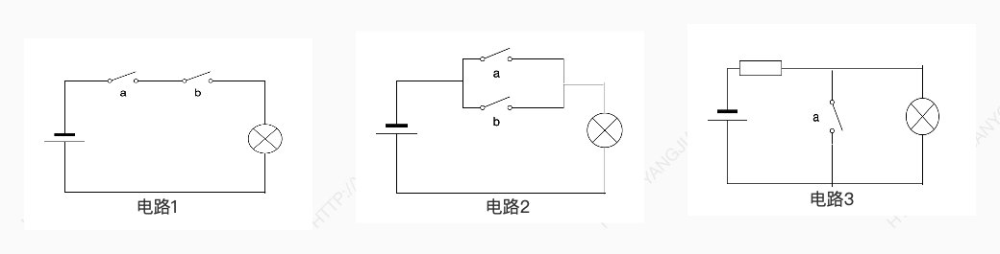
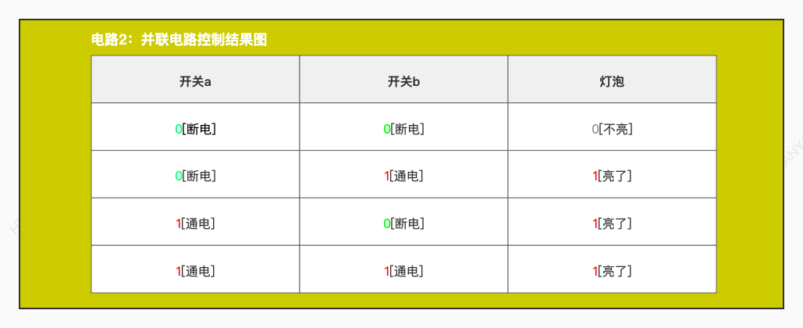
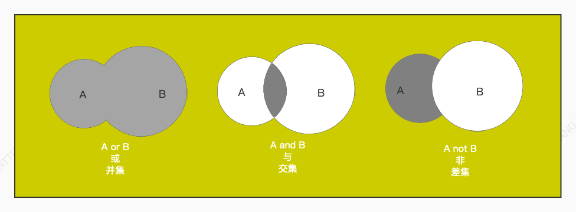
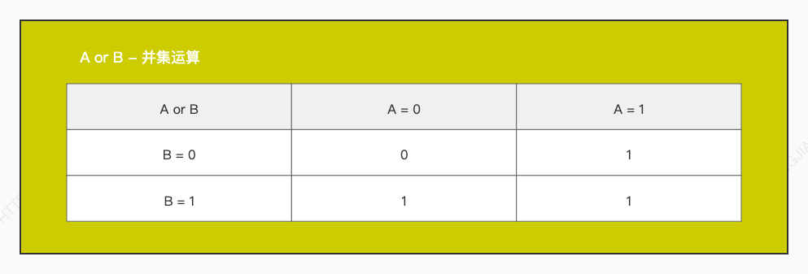
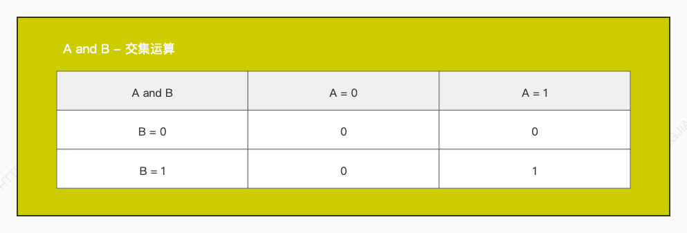
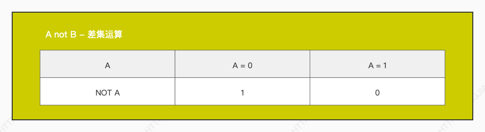

What actually is a CPU, and why can a piece of silicon perform mathematical operations?

## Simple Physical Circuits

Let's start with a basic physics circuit diagram from school:

Here we have three basic arrangements: a series circuit, a parallel circuit, and an inverter (note: the inverter symbol isn't drawn to strict IEEE standard).

In the diagram, `a` and `b` are switches controlling whether current flows to turn a light bulb **on** or **off**.

Let's represent the switch state with `1` (closed/powered) and `0` (open/unpowered), and the bulb state with `1` (lit) and `0` (dark).

From basic circuit physics, those three circuits produce the following three outcome tables:

Don't underestimate these three simple switch-and-bulb tables—they form the physical foundation of modern computing. Even a complex modern CPU evolved from building blocks just like these. To see how that leap happened, we need two pioneers: British mathematician **George Boole** and American electrical engineer **Claude Shannon**.

***

## George Boole

George Boole formalized two foundational ideas: **sets** and **Boolean logic**.

In set theory, there are three fundamental operations—union, intersection, and complement—illustrated below:

If you have ever wondered where the `OR`, `AND`, and `NOT` operators we use every day in programming come from, this is their origin: union corresponds to `OR`, intersection to `AND`, and complement/negation to `NOT`.

Now consider **Boolean logic**, which operates strictly on two values: `0` and `1`. Looking at the **truth tables** for `OR`, `AND`, and `NOT`:

Look closely at those three Boolean truth tables: **they are identical to the three electrical circuit tables above.**

That bridge between physics and mathematics is the breakthrough: mathematical logic can be physically realized using electrical circuits.

***

## Claude Shannon

In 1932, **Claude Shannon** entered the University of Michigan, where he encountered George Boole's work, and later joined MIT to work on the **Differential Analyzer**—an early mechanical analog computer used in major engineering projects.

Shannon's landmark insight was connecting binary electronic switches (`1` and `0` for on and off) directly to Boolean logic (`1` and `0` in truth tables) and binary arithmetic. By replacing slow mechanical linkages with electronic switching circuits that implement Boolean gates, he laid the foundation for **Digital Circuit Design**.

***

## From 1-Bit Addition to Complex Math

Once electronic circuits can perform basic 1-bit binary addition, how do we get to complex scientific math? Mathematicians reduce higher-level operations—via numerical methods, series expansions, Fourier transforms, and calculus approximations—into sequences of additions, shifts, and comparisons. Because circuits can execute those fundamental operations at billions of cycles per second, a CPU gains general-purpose computing power.

## Summary

At its core, a **CPU** is an extraordinarily dense network of switching circuits, and it computes by orchestrating Boolean logic and binary arithmetic directly in hardware.
