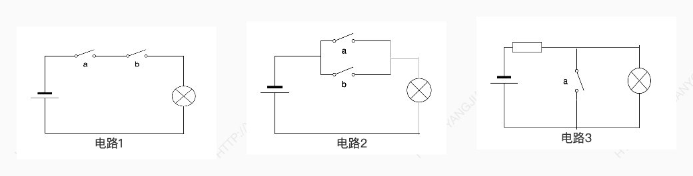
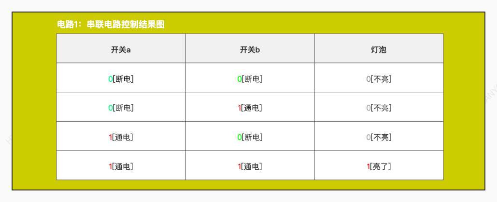
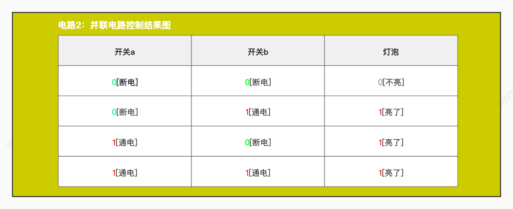
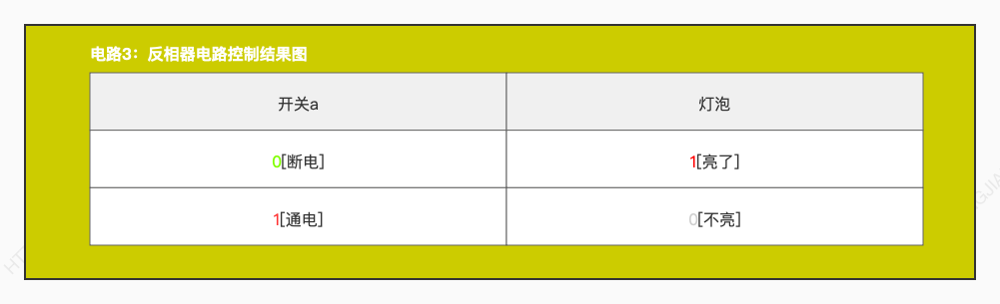
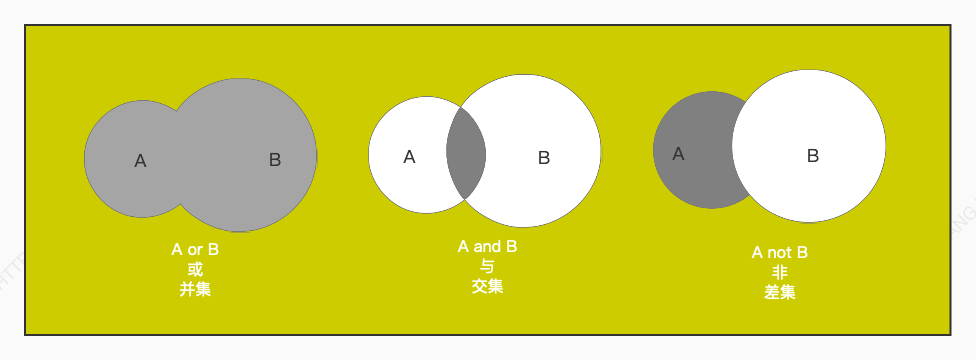
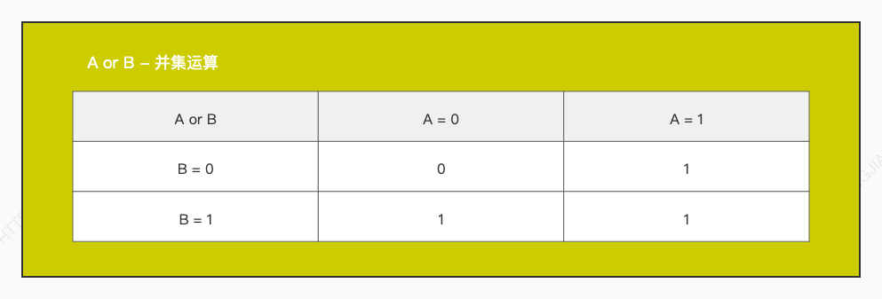
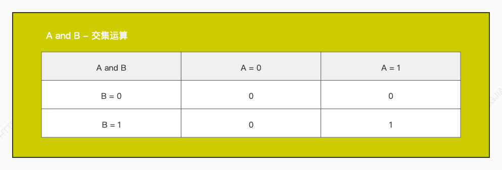
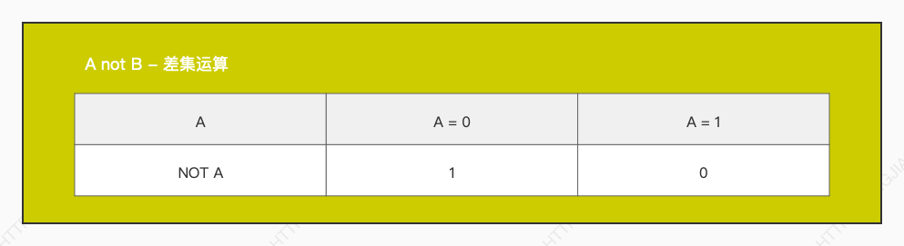

What exactly is a CPU, and how does it execute mathematical operations?

## Simple Physical Circuits

Start with a familiar physics circuit diagram:

The diagram shows three elementary circuits: series, parallel, and an inverter (drawn informally rather than with strict standard symbols).

Switches `a` and `b` control whether electricity reaches the light bulb. Using `1` for **on/lit** and `0` for **off/dark**, each circuit produces a predictable input-output table:

Simple as they look, these three tables represent the physical bedrock of modern computers. A modern CPU is built by composing billions of tiny switches acting according to rules just like these.

***

## George Boole

British mathematician **George Boole** introduced **set operations** and **Boolean logic**. The three core set operations—union, intersection, and complement—map directly to logical operators used in code every day:

- Union -> `OR`
- Intersection -> `AND`
- Complement -> `NOT`

In Boolean logic, values are restricted to `0` and `1`. Their truth tables look like this:

Compare these Boolean truth tables with the three electrical circuit tables above—**they match row for row**. Mathematics and physics meet right here, giving electrical circuits the ability to evaluate logical expressions.

## Claude Shannon

In 1932, **Claude Shannon** studied George Boole's theory at the University of Michigan and later worked on MIT's mechanical **Differential Analyzer**. Shannon realized that electronic switches (`1`/`0`), binary numbers (`1`/`0`), and Boolean truth tables are all manifestations of the same algebra, founding the field of **Digital Circuit Design** and showing how electronic switches can execute logic and arithmetic.

***

## Scaling from Binary Addition to Complex Computation

Once hardware circuits can add binary digits, complex mathematical operations—from square roots and trigonometry to calculus and Fourier transforms—can be broken down numerically into repeated additions and logical operations. Hardware circuit design turns those mathematical rules into high-speed execution.

## Summary

A **CPU** is fundamentally a vast collection of carefully engineered switching circuits that perform computation by executing Boolean logic and binary arithmetic in silicon.
