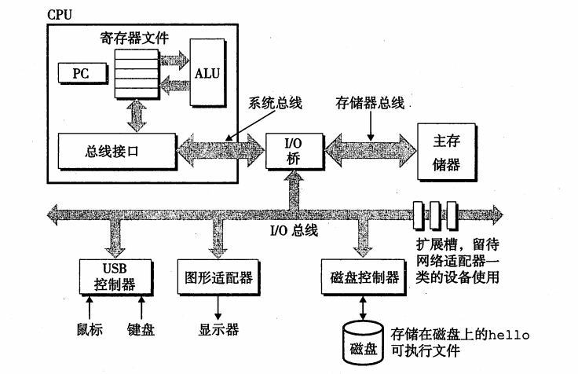
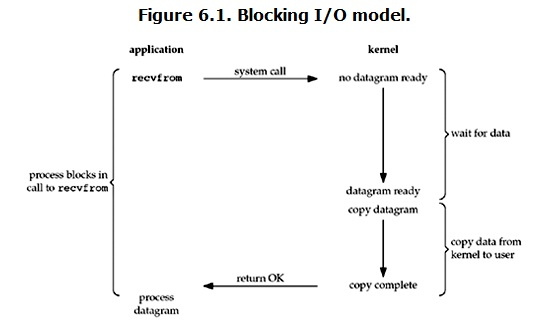
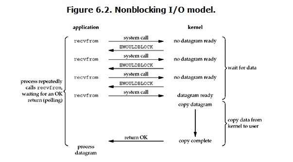
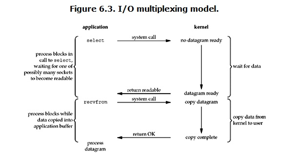
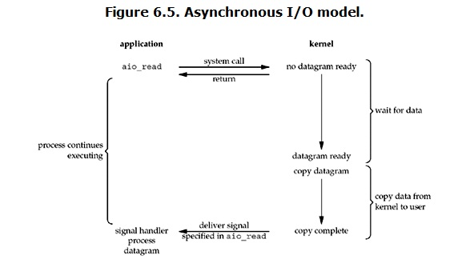
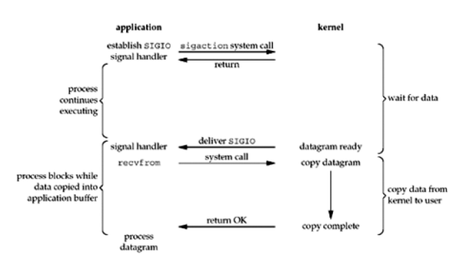

In this post, we answer three classic systems questions:
1. What are the 5 I/O models?
2. What is the real difference between **synchronous vs. asynchronous** and **blocking vs. non-blocking**?
3. How do `select`, `poll`, and `epoll` work?

## Part 1: The 5 I/O Models

- **Blocking I/O** (`BIO`)
- **Non-Blocking I/O** (`NIO`)
- **I/O Multiplexing**
- **Asynchronous I/O** (`AIO`)
- **Signal-Driven I/O** (`SIGIO`)

### Background: Hardware, OS, and Kernel vs. User Space

Modern computer hardware consists of **buses**, **I/O devices**, **main memory**, and the **processor (CPU)**:

- **Bus**: Electrical pathways carrying bytes of information across components.
- **I/O Devices**: Interfaces to the outside world (keyboard, mouse, network card, display).
- **Main Memory**: Temporary storage holding running programs and their data.
- **CPU**: The engine that fetches and executes instructions from memory.

The **operating system** sits between hardware and applications, protecting hardware from misbehaving apps while providing clean abstractions: **processes**, **virtual memory**, and **files**.

To protect the kernel, virtual memory is split into **kernel space** (with direct hardware access) and **user space** (where application processes run). User processes must invoke kernel system calls (such as `read` and `write` on Linux) to interact with hardware.

***

### 1. Blocking I/O (`BIO`)

When a process calls `recvfrom`, the kernel begins the I/O operation in two phases:
1. Waiting for data to arrive and be ready in kernel space.
2. Copying the data from kernel space into user space.

In **Blocking I/O**, the calling thread is suspended through *both* phases until data arrives in user space.

> **Milk-tea shop analogy:** You (the process) walk into a shop (the OS), order a milk tea (`recvfrom` syscall), and stand at the counter doing nothing until the barista makes it (kernel prepares data) and hands it over (copies to user space).

### 2. Non-Blocking I/O (`NIO`)

When a process calls `recvfrom` on a non-blocking socket and data is not ready yet, the kernel immediately returns an error (`EWOULDBLOCK` / `EAGAIN`) instead of putting the process to sleep. The process then repeatedly polls `recvfrom` until data is ready, at which point the kernel copies it to user space.

> **Analogy:** You order a milk tea, the barista immediately says "Not ready yet," and you keep asking "Is it ready yet?" in a loop until it's done.

### 3. I/O Multiplexing

I/O Multiplexing (also known as **Event-Driven I/O**) uses system calls such as `select`, `poll`, or `epoll` so a **single process** can monitor **many sockets** at once. The process blocks on `select`/`epoll_wait` until one or more sockets become readable/writable, and then reads the ready sockets.

> **Analogy:** Multiple customers hand order slips to the barista. Whenever a drink is ready, the barista checks the slips and calls the matching customer to pick it up.

### 4. Asynchronous I/O (`AIO`)

In **Asynchronous I/O**, the process initiates the I/O request and immediately returns to do other work. The kernel handles *both* waiting for data and copying it into the user-space buffer, and only notifies the process (via a signal or callback) once the entire operation is complete.

> **Analogy:** You order a milk tea, leave your phone number, and go run other errands. The barista makes the drink, puts it at pickup, and calls you only when everything is ready.

### 5. Signal-Driven I/O (`SIGIO`)

In **Signal-Driven I/O**, the process registers a `SIGIO` signal handler and continues running without blocking. When data is ready in kernel space, the kernel sends `SIGIO` to trigger the handler, which then copies the data from kernel to user space. Because signals are noisy and hard to scale for TCP sockets, this model is rarely used in practice.

***

## Part 2: Synchronous vs. Asynchronous, Blocking vs. Non-Blocking

> [!IMPORTANT]
> To understand these four terms clearly, treat them as **two orthogonal dimensions** describing coordination vs. waiting state—do not conflate them with the naming of the 5 I/O models above.

### Synchronous vs. Asynchronous (Coordination & Dependency)

- **Synchronous**: Steps or participants in a task must proceed in a coordinated order—downstream progress depends on waiting for the current step to finish.
- **Asynchronous**: Steps proceed without strict sequential waiting; completion is decoupled via callbacks, events, or notifications.

### Blocking vs. Non-Blocking (State While Waiting)

- **Blocking**: While waiting for a condition/result, the caller is suspended and cannot do anything else.
- **Non-Blocking**: If the operation cannot complete immediately, the call returns right away so the caller isn't stuck waiting.

### Mapping the 4 Combinations to the I/O Models

| | **Blocking** | **Non-Blocking** |
|---|---|---|
| **Synchronous** | **BIO / I/O Multiplexing** | **NIO** |
| **Asynchronous** | **—** | **AIO** |

- **BIO**: Suspended during both waiting and copying, and completion depends directly on the kernel -> **Synchronous Blocking**.
- **NIO**: Returns immediately while polling (non-blocking), yet the process still actively polls and drives the synchronous copy -> **Synchronous Non-Blocking**.
- **I/O Multiplexing**: `select`/`poll`/`epoll` still blocks waiting for readiness and synchronously copies data -> **Synchronous Blocking** (multiplexed across many descriptors).
- **AIO**: Caller neither blocks on waiting nor performs the synchronous copy; kernel notifies on completion -> **Asynchronous Non-Blocking**.

***

## Part 3: What Are `select`, `poll`, and `epoll`?

`select`, `poll`, and `epoll` are three Linux mechanisms for implementing **I/O Multiplexing** (monitoring multiple file descriptors from a single process).

- **`select`**: Passes a set of file descriptors to the kernel. When any descriptor becomes ready, the kernel wakes the process, which must scan all monitored descriptors to find which ones are ready—giving **$O(N)$** time complexity. `select` also enforces a hard limit (typically **1024** file descriptors per process via `FD_SETSIZE`).
- **`poll`**: Works much like `select` with **$O(N)$** scanning, but uses a linked/array structure of `pollfd` instead of a fixed bitmask, removing the 1024-descriptor limit.
- **`epoll`**: Registers descriptors once via `epoll_ctl` and attaches kernel callbacks. When a descriptor becomes ready, it is added directly to a ready list returned by `epoll_wait`. There is no full scan of idle descriptors, achieving **$O(1)$** per-event efficiency and scaling smoothly to tens of thousands of concurrent connections.

***

## Summary

- Among the 5 I/O models, **BIO**, **NIO**, **I/O Multiplexing**, and **AIO** are the most important: BIO and I/O Multiplexing are synchronous blocking, NIO is synchronous non-blocking, and AIO is asynchronous non-blocking.
- **Synchronous vs. asynchronous** describes step dependency/notification; **blocking vs. non-blocking** describes whether the caller's execution is suspended while waiting.
- `select`, `poll`, and `epoll` all implement I/O multiplexing, with `epoll` delivering **$O(1)$** readiness notification compared to **$O(N)$** linear scanning in `select` and `poll`.
