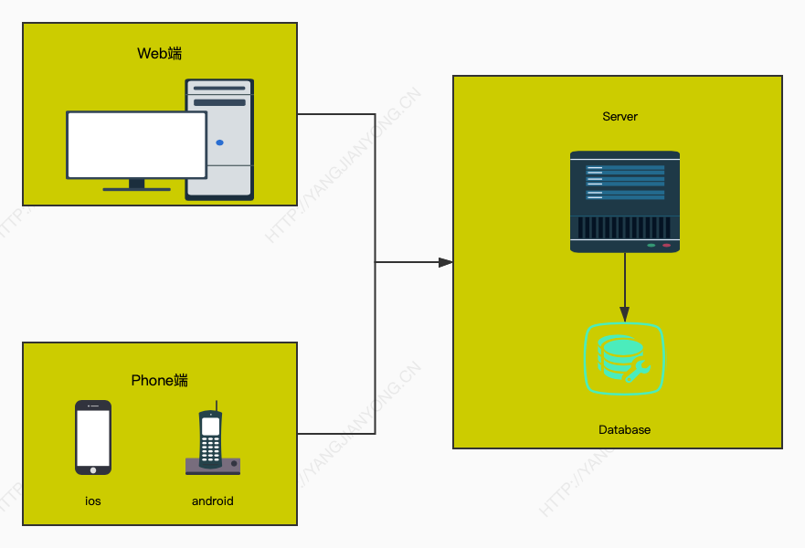
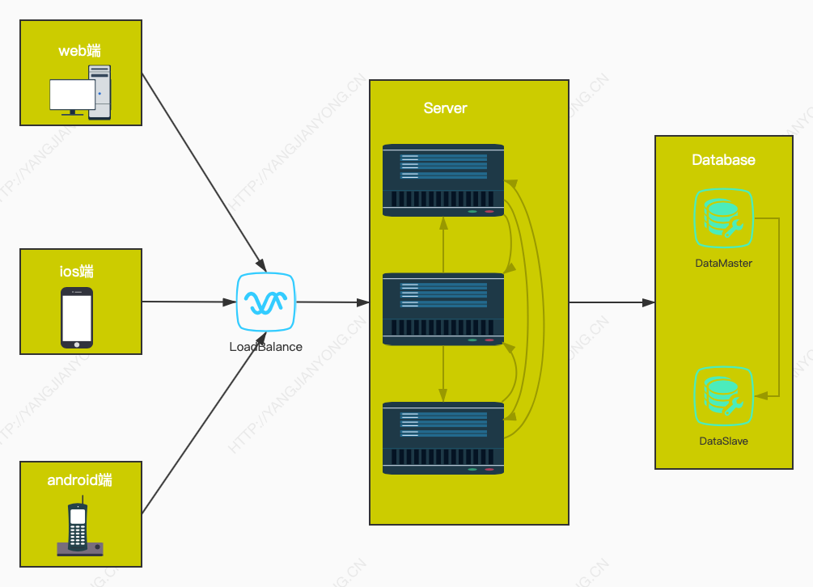
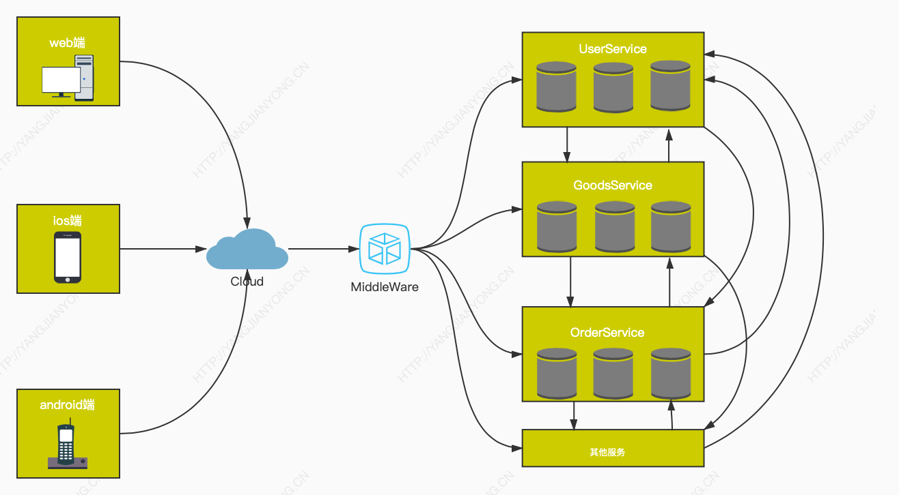
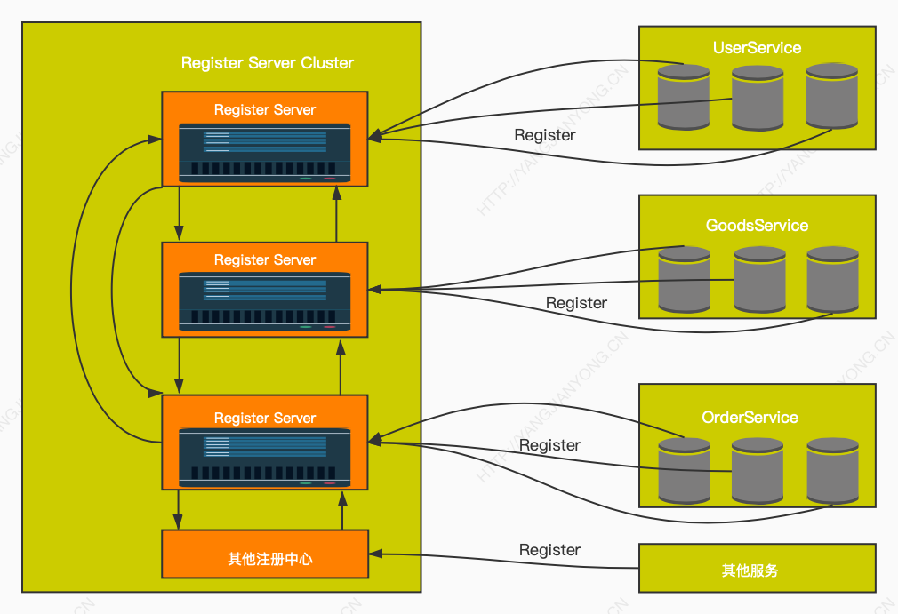
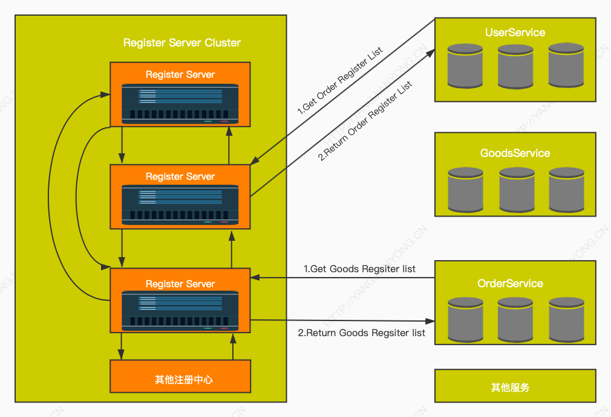
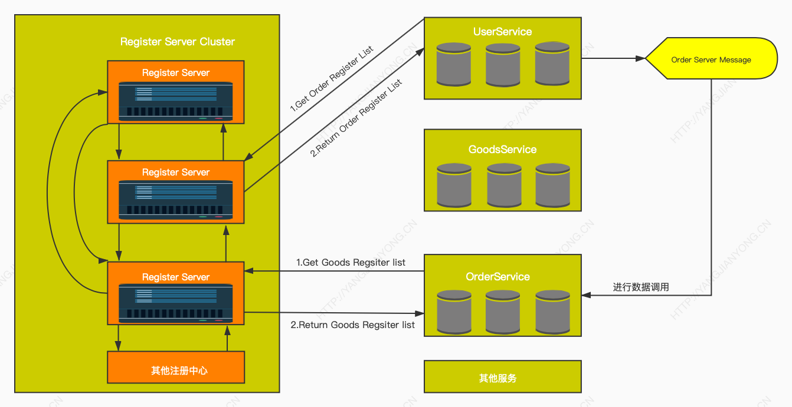
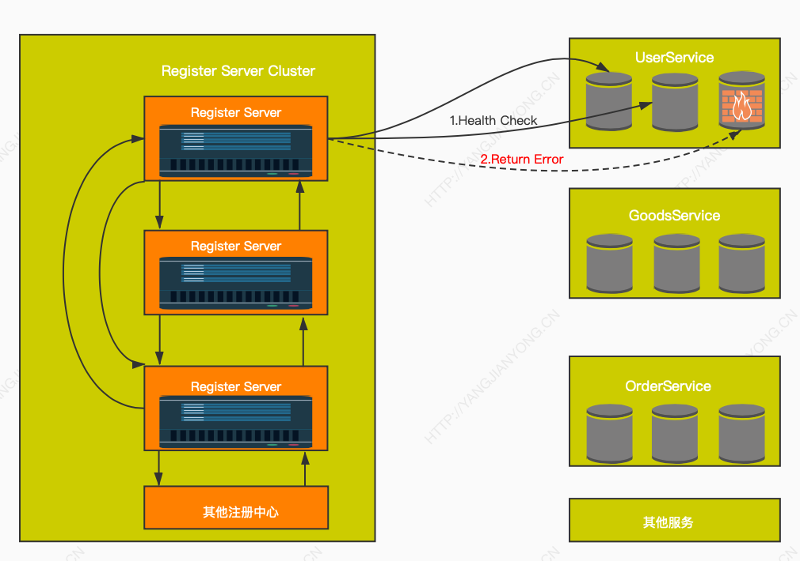

Microservices have become one of the most popular software architectures for scaling engineering productivity. In short, a microservices architecture breaks a large monolithic system into small, independently runnable services organized around business capabilities, communicating over well-defined APIs and often owned by independent teams.

> **Analogy:** Before assembly lines, a single worker had to build an entire car from engine to chassis. On an assembly line, specialized workshops build standardized components independently and assemble them together. Similarly, in an e-commerce platform, User, Product, Order, and Billing modules become independent services with standard API contracts rather than one tightly coupled codebase.

***

## Core Characteristics of Microservices

- **Fine-grained**: Each service focuses on doing one thing well (e.g., the User service handles only user concerns, decoupled from Orders or Products).
- **Autonomous**: Each service can choose its own tech stack, deploy independently, and run in isolation.
- **Lightweight communication**: Services typically communicate over lightweight protocols such as REST/HTTP or RPC.

***

## Key Benefits

- **Agility**: Small, autonomous teams own their services end-to-end, shortening development cycles and increasing overall throughput.
- **Flexible scaling**: Individual services can be scaled independently based on demand without scaling the entire application.
- **Independent deployment**: Teams can ship updates, run CI/CD, and roll back quickly with a smaller blast radius.
- **Technology freedom**: Teams can pick the best language and datastore for each workload rather than being locked into a single stack.
- **Reusable capabilities**: Well-defined services act as building blocks that new features can compose without rewriting core logic.
- **Resilience**: A failure in one non-critical service can degrade gracefully instead of crashing the entire system.

***

## Problems Microservices Solve

- **Parallel development**: Teams work concurrently across decoupled services instead of stepping on each other in a monolith.
- **Faster time to market**: Shorter release cycles help ship features faster.
- **Easier extensibility**: Adding new modules or capabilities is cleaner when boundaries are explicit.
- **Higher availability**: Redundant replicas of critical services keep the overall platform stable even when individual instances fail.

***

## Service Registration and Discovery

**Service registration** means each service instance publishes its network location (IP and port) to a central registry such as **ZooKeeper** or **Consul**. **Service discovery** is the counterpart: callers query the registry to find live endpoints for the services they need to call.

To see why this matters, trace the evolution of web architecture:

### Web 1.0 Architecture

Clients (`Web / iOS / Android`) talk directly to a single server, often co-located with the database. Simple, fast, and effective for small systems.

### Web 2.0 Architecture

As traffic grows, multiple application servers sit behind a load balancer, paired with primary-replica databases. Still, service-to-service discovery isn't required yet.

### Entering Microservices

When a system splits into `Order`, `Goods`, and `User` services—deployed in containers on Docker/Kubernetes—hardcoding `IP:Port` pairs in config files quickly breaks down as instances scale up, scale down, or reschedule.

### Service Registration

When `Order`, `User`, or `Goods` instances start up, they register their `IP` and `Port` with the **Register Server Cluster**.

### Service Discovery

When a service needs to call another service, it queries the service registry (via HTTP polling, pub/sub watch, or RPC) to retrieve live target addresses—eliminating manual config updates.

### Service Invocation

Once the caller obtains the target address from the registry, it sends the request directly to the upstream instance.

### Health Checks

Service registries also run **health checks**. If an instance stops returning a healthy status (such as HTTP `200`), the registry marks it unavailable and routes traffic only to healthy backup replicas.
