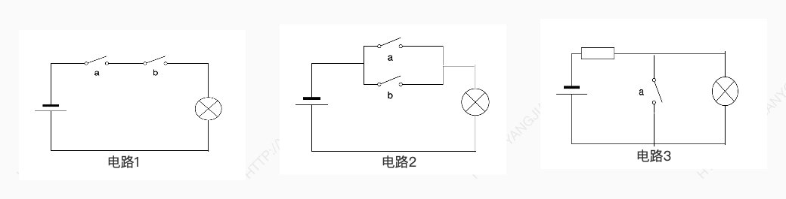
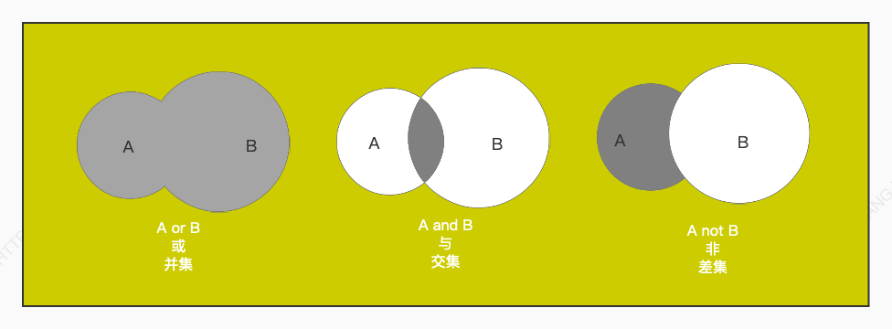
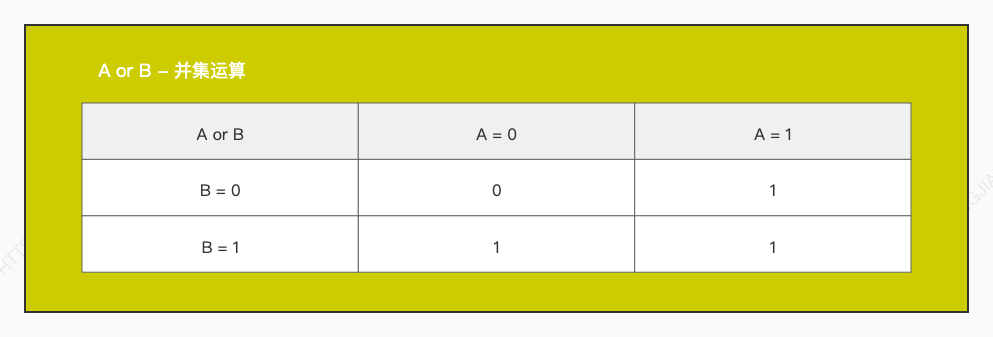
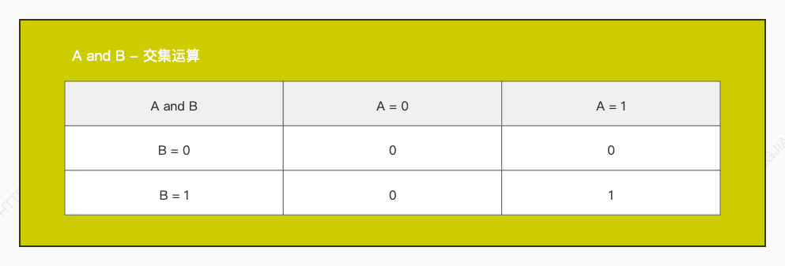
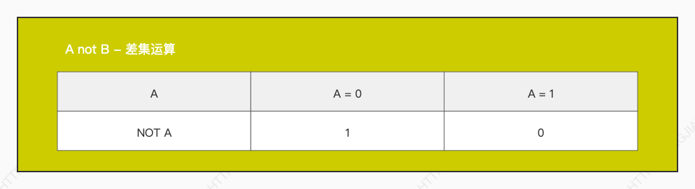

## CPU到底是什么东西？它为什么能够执行数学运算？

## 简单的物理电路

#### 先来看一张初中学过的物理电路图:

#### 从图中我们可以看出这是一个简单的串联和并联还有反相器的电路。[注：反相器没有按照标准来画]

#### 图中的 `a` 和 `b` 代表着控制电路的开关，通过控制这两个开关的通电状态来控制灯泡的`亮`与`不亮`。

#### 我们用数字 `1` 和 `0` 来表示开关的`通电`和`断电`的状态表示，`1` 表示`通电`状态，`0` 表示`断电`状态。同样的，我们也用数字 `1` 和 `0` 来表示灯泡`亮`与`不亮`的状态， `1` 表示灯泡`亮了`，`0` 表示灯泡`不亮`。

#### 那么通过我们学过的物理电路的知识，上图中三个电路，分别有以下三种控制结果：

#### 以上三个表格分别表示就是对应了上图中三个电路通过对开关的控制，进而控制灯泡的亮与否。

#### 别小看了这三个简单的电路控制结果的表格，因为这是现代计算机产生的物理基础。可以说，现代计算机的产生就是由这个演变而来的。一个复杂的 `CPU` 就是从这么简单的电路演变而来的。至于怎么演变来的，接下来该是英国数学家 `乔治·布尔` 和美国电子工程师 `克劳德·艾尔伍德·香农` 登场了。

------------

## 乔治·布尔

#### 乔治布尔这个数学家发明了两个概念：一个叫`集合`，一个叫`布尔逻辑`。咱们先来看下集合。有学过数学的都知道在集合中，有存在着三种操作，分别是：交集、并集、差集。如下图所示：

#### 相信从上图中，有解开一部分程序员的疑惑，那就是我们在写代码的过程中，一直用到的 `OR / AND / NOT` 逻辑操作，到底是从哪里来的。其实我们用的就是这个伟大的数学家提出的这个集合的概念以及三种最基本的运算。从上图中可以看出，第一个就是 `并集` 的运算，第二个就是 `交集` 的集合运算，第三个就是 `差集` 的集合运算。而使用到的符号就是这个数学家发明的：`[OR]或、[AND]与、[NOT]非`

#### 再来看下 `布尔逻辑` 。在布尔逻辑中，只使用两个值，一个是 `0`，一个是 `1`。讲这个布尔逻辑这么简单到底有啥用呢？再来看下一个叫 `真值表` 的东西，表格如下：

#### 这三个表格到底在表达什么呢？可能细心的童鞋已经发现了。其实以上三个表格，就是实现了布尔逻辑中，`0` 和 `1` 之间的交集和并集的运算

#### 那么再细心一点的童鞋又可能发现了。实际上，这三个表格的运算结果，跟上面的前三个电路控制结果的表格就是一样的

#### `也就是说，物理跟数学这两个跨界的学科，找到一个相关联的计算方式。由此奠定了数学运算用物理电路的形式实现了`。这点很重要，因为这里数学跟物理有共通的地方，从而实现了让物理电路从此有了数学计算的能力。至于怎么计算的，`克劳德·艾尔伍德·香农` 出现了。这个伟大的电子工程师创造了 `数字电路设计` 这个学科

## 克劳德·艾尔伍德·香农

#### `克劳德·艾尔伍德·香农` 原本是在1932年进入到密歇根大学学习，在这个大学里首次接触到了 `乔治·布尔` 的理论，后来又进入到了麻省理工学院参与了 `微分分析机` 的研究工作。`微分分析机` 是一台机械式的计算机，不要小看这台机械式的计算机，这可是参与了很多重要工程，包括曼哈顿计划，就是造原子弹的，很多计算都是靠这种早期的计算器计算出来的。`在这里不得不服咱们国家的科研人员，由于当时的技术封锁，咱们国家的科研人员硬是用算盘敲出的原子弹，真的是硬核到不行的操作。`

#### 讲了那么多，那么 `克劳德·艾尔伍德·香农` 具体的贡献是什么呢。通过上面的长篇讲解我们已经知道了一些东西：电子开关的通断电可以用 `1` 和 `0` 来表示；布尔逻辑也是 `1`和 `0`；电子开关的通断电控制灯泡的亮与否，跟真值表的计算结果是一样的；`1` 和 `0` 刚好是二进制。而香农的贡献就是，在原来是机械式的计算机上面，引入了电子控制的方式，可以用电子开关模拟布尔逻辑运算了
#### 至于电路为什么能够实现运算，在这里就不进行其他的解释了。这已经进入到了另一个领域了，叫做《数字电路设计》

------------

## 题外话

#### 复杂的数学计算怎么通过物理电路实现：既然计算机能够实现简单的1位二进制的加法，那么怎么实现更加复杂的数学运算。这就要感谢数学家。数学家将复杂的数学运算简化到数学上的加法运算【咱们国家的原子弹制造就是将复杂的函数运算用算盘打出来的】。数学家运用各种数学工具，比如傅立叶变换、平方开方微积分等等，将数据的计算都换成了加法计算

#### 也就是说，数学上复杂的运算可以通过各种数学工具简化到加法运算，那么就能通过对电路的设计来实现计算，这也就让计算机有了更加强大的计算能力。

## 总结：CPU是什么。本质上，CPU就是一堆复杂的电路。而为什么能够实现计算，通过对电路的设计来实现计算的
