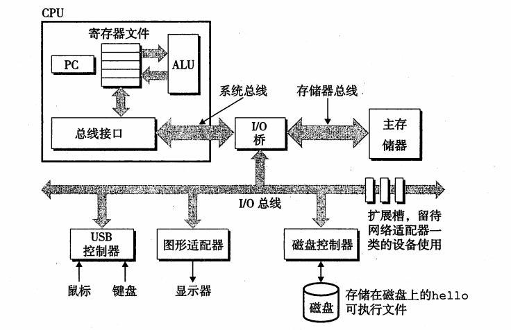
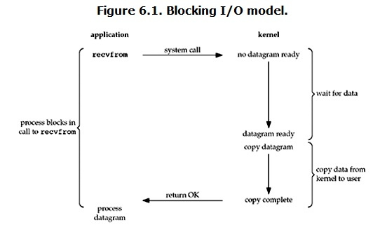
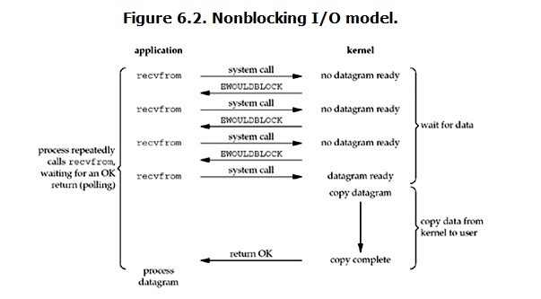
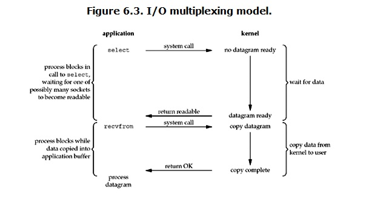
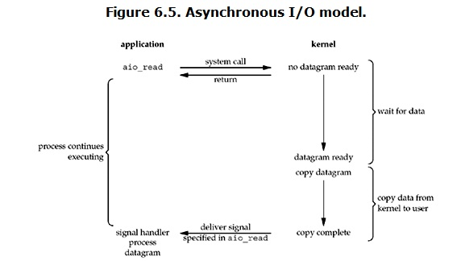
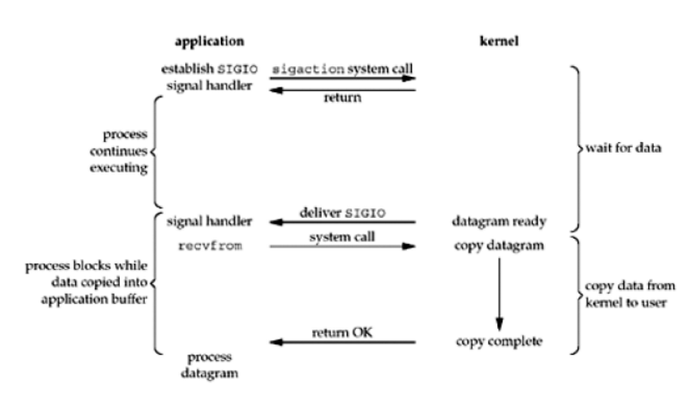

## 系统中有哪5种`IO`模型？什么是 `select/poll/epoll`？同步异步阻塞非阻塞有啥区别？

## **先解开第一个疑惑：有哪五种I/O模型**
#### - `Blocking I/O`【阻塞I/O】
#### - `NonBlocking I/O`【非阻塞I/O】
#### - `Multiplexing I/O`【I/O多路复用】
#### - `Asynchronous IO`【异步I/O】
#### - `Signal Driven IO`【信号驱动I/O】

#### 这些`IO`模型具体是怎么工作的，往下看。

------------

## 先来一波前提的讲解
#### 整个计算机系统涉及到了硬件基础跟操作系统这两部分，而我们开发的软件则是运行在系统之上的。

#### 先来看下现代计算机系统的硬件组成部分：`总线、I/O设备、主存、处理器`

#### `总线` 是一组电子管道，这个管道贯穿了整个计算机系统，主要的工作就是携带信息字节在各个部件之间传递。

#### `I/O设备` 就是系统与外部世界的连接通道。例如鼠标/键盘/显示器等等。

#### `主存` 则是一个临时的存储设备，用来存放程序以及程序要处理的数据。

#### `处理器就是中央处理单元【CPU】` 就是用来解释存储在主存中的指令的引擎。讲的明白点，就是把要计算的数据以及计算过程丢给处理器，然后让它计算得到我们想要的结果。

#### `操作系统` 就是我们熟知的 `windows/linux/unix` 操作系统。操作系统是位于硬件跟应用程序之间的一层软件，该软件（操作系统）提供了两个基本的功能：一个是防止硬件被失控的应用程序滥用；一个就是向应用程序提供了一种简单一致的机制来控制不同的硬件设备。而怎么实现这两种功能的呢，是通过三个基本的抽象概念来是实现的，分别是：进程、虚拟内存以及文件。而这个进程，就是我们今天要讲的主角，至于虚拟内存跟文件在这里就先不讲了。对于进程使用的学习，是作为程序员的必须课之一。

#### `内核空间跟用户空间` 上面已经提到了，在硬件之上，有一层操作系统，更上层的是应用程序。操作系统可以直接控制硬件，可以访问到受保护的内存空间。而应用程序的进程则不可以直接操作硬件。为了保护操作系统的内核运行，操作系统将虚拟空间划分为两部分：内核空间、用户空间。至于这两个概念的详细介绍这里就先不写了。在这里只需要知道进程是运行在一个叫虚拟内存空间上的，这个虚拟内存空间有一部分是内核使用的，叫内核空间，有一部分是进程使用的，叫用户空间。而进程需要操作硬件，只能通过调用操作系统提供的内核函数来实现，例如 `linux` 中的 `read` 操作和 `write` 操作。

------------

## **开始进入主题**

####  `什么是进程？` 前面的讲解我们已经知道了，操作系统是位于硬件跟应用程序程序之间的一层软件。而我们开发的各种应用软件，比如 `Photoshop/微信/QQ` 等等，都是运行在这个操作系统上面的。那么我们的各种应用软件是怎么来使用硬件的以及怎么保证各个应用软件之间的数据不会错乱呢？`进程` 登场了
#### `进程` 就是操作系统提供的一种抽象概念，这个概念给各种应用软件提供了一种假象，让不同的应用软件看上去好像是单独的占用硬件资源，让硬件单独的处理我这个正在运行的软件。也就是说一个进程代表着一个软件正在执行的过程。但是我们的电脑上，肯定不止开了一个软件，肯定一次性开了好几个，那么操作系统就会建立起很多个不同的进程来处理不同的软件。但是 `CPU` 一次只能处理一种程序，当有不同的程序需要同一个 `CPU` 处理怎么办？就是我们这篇文章的重点登场了：五种I/O模型来实现并发的处理不同的程序
#### `上面那么讲解进程的概念，一开始新手肯定理解起来很吃力。举个例子来说明吧：`
#### `我们小时候肯定玩过积木，而刚购买过来的积木里面有一些已经画好的图形教程，教我们怎么搭建出不同的造型，我们照着这个图形来搭建积木，搭建出一个造型`
#### `在上面的例子中，我们人就是处理器，也就是CPU；而那些图形教程就是程序，也可以说是算法；剩下的那些各种各样的积木就是要输入的数据。那么进程就是我们人学习了图形教程，然后使用了各种各样的积木，搭建出不同造型的整个过程的总和`

## 下面讲解五种 `I/O` 模型

### `1.Blocking I/O`【阻塞I/O】

#### `Blocking I/O` 也叫 `BIO`，也就是 `阻塞IO`。从图中可以看出当进程了调用了 `recvfrom` 的系统调用，`kernel` 就开始了进行 `IO` 操作了，这个操作就是准备数据。而这个准备数据是需要一个过程的，内核需要获取数据，需要等待数据被拷贝到内核空间，然后再将数据从内核空间拷贝到用户空间。这其中涉及到两个过程，一个就是操作系统内核需要等待数据被拷贝到内核空间，另一个过程就是将数据从内核空间拷贝到用户空间。在这个 `阻塞IO` 模型中，在数据还没到达用户空间之前，这两个过程都是阻塞的，一直处于 `Blocking` 的状态。这就是 `阻塞IO`，也叫 `BIO`
`用生活的例子来理解阻塞IO：一个客户就是一种软件，奶茶店就是操作系统，制作奶茶的机器就是CPU`
`客户到奶茶店，客户跟奶茶店的店员说要买奶茶【进行了系统调用】，客户啥事也不干就瞎等着【阻塞状态】，而店员接到这个客户要求后，就开始使用机器制作奶茶【内核准备数据】，等到制作好了之后【内核准备好了数据】，再把奶茶放到前台【将数据从内核空间拷贝到用户空间】，并且通知客户自己过来取奶茶，客户拿了之后走人【进行read操作】`

#### `客户到奶茶店说要买奶茶、机器制作奶茶、店员把奶茶拿到前台、客户取走的整个过程就是一个进程`

#### `2.NonBlocking I/O`【非阻塞I/O】

#### `NonBlocking I/O` 也叫 `NIO`，也就是 `非阻塞IO`。同样从图中可以看出当进程调用了 `recvfrom` 的系统调用，`kernel` 一样就开始了 `IO` 操作。但是同 `BIO` 不同的是，`BOI` 会把内核准备数据的过程给挂起【阻塞】，直到内核准备好了数据才返回。而  `NIO` 则是直接先返回一个 `error` 告知进程数据还没准备好。同样的在进程端，也不用一直傻傻的等待，当得到一个数据还没准备好的错误时，会再次发送系统调用，直到内核准备好了数据，再从内核空间将数据拷贝到用户空间。`NIO` 最大的特点就是，进程需要不断的询问 `kernel` 数据准备好了没。`在我看来这是非常傻的操作，可能我理解的不够透彻～～`

`举例：客户到奶茶店，客户跟店员说要买奶茶【进行系统调用】，这时候店员直接跟客户说稍等一下还没做好【直接返回error】，然后一边开始使用机器制作奶茶【内核准备数据】。而客户这边的做法则是重复的询问店员奶茶是否做好了，直到店员把奶茶做好为止。同样的，这期间客户除了一直询问之外，啥事也没干【阻塞状态】。如果没做好，店员一样是回答还没有，如果做好了，则是把奶茶拿到前台【拷贝到用户空间】并且告知客户，让客户过来拿走【read操作】`

#### **`跟阻塞IO唯一不同的是，在数据还没准备好之前，进程会一直重复的询问`**

####  `3.Multiplexing I/O`【I/O多路复用】
)

#### `Multiplexing I/O`，就是 `IO多路复用`。在这里可能童鞋们就会发现这种`IO`方式跟前面的已经不同了，直接将 `IO多路复用` 可能大家不知道是什么，如果提到 `select/poll/epoll`，在这里肯定大家都有所耳闻。`IO多路复用`也叫 `Event Driver IO`【事件驱动IO】。至于什么是 `select/poll/epoll`，等会再讲解

#### 先来看下 `IO多路复用` 是怎么工作的。从图中可以看到，操作系统提供了一个叫 `select` 的系统调用，当一个用户进程调用了 `select`，则该用户进程所负责的所有 `socket` 同样被 `select` 所负责。对于内核，则监听着所有 `select` 负责的`socket`。当调用了 `select` 之后，`select` 会不断的轮询所有的 `socket` ，当某个 `socket` 有数据到达了，`select` 就会返回，告知用户进程将数据拷贝从内核空间拷贝到用户空间

`举例：跟上面的两种方式有很大的不同。假如有很多客户来买奶茶，每个客户用一个卡片将自己的姓名跟要买的奶茶型号写在上面，然后统一交给店员。每一次店员做好奶茶后，要在一堆卡片中，根据做好的奶茶型号找到对应的姓名，通知客户过来取奶茶。在这种方式上，每一次店员奶茶做好后，需要花大量的时间在一堆卡片中寻找客户。同样的，客户在等待奶茶做好之前，啥事都没干只有瞎等着【阻塞状态】`

####  `4.Asynchronous IO`【异步I/O】

#### `Asynchronous IO` 也叫 `AIO`，也就是 `异步IO` 。其实 `异步IO` 是最好理解的。`异步IO` 就是当用户进程发起了一个系统调用之后，内核直接返回 `error`，而用户进程接收到返回后，不再等待直接干其她事情去了。剩下的数据准备工作内核就自己去干了，等数据准备好了，不再通知用户进程来拷贝数据，而是自己顺手将数据从内核空间拷贝到用户空间。当所有事情都做完之后，只需要给用户进程发送一个信号【`Signal`】，告知到用户进程直接读取数据就行了【进程`read`操作】
`举例：客户到奶茶店后，直接跟店员说要买哪种奶茶，然后留一个电话号码给店员就回去了【不再是阻塞状态了】，店员在奶茶做好后，再打电话通知客户过来取`

#### `在AIO这个方式上，最大最大的区别在于，当进程发起系统调用，进程不再傻乎乎的等着了，而是去处理其他事情去了`

#### `5.Signal Driven IO`【信号驱动I/O】

#### `Signal Driven IO` 也叫 `SIGIO`，也就是`信号驱动IO`。`信号驱动IO`在实际的开发中是很少用到的，因为无用的信号太多了。在该模型中，从图中可以看出当进程调用了系统调用后，该模型会给对用的 `socket` 请求建立一个信号处理器，进程并不会被挂起。当内核准备好数据时，内核就会产生一个`SIGIO`信号给之前建立好的信号处理器，然后信号处理器就可以进行读写操作。`由于该模型很少使用，在这里不再详细讲述`

------------

## **第二个问题：同步异步阻塞非阻塞有啥区别**
#### 首先，在开始之前，重要的事情说三遍

`**此处要讲解的概念跟上面五种IO模型中提到的同步异步阻塞非阻塞没有绝对的关联关系**`
`**此处要讲解的概念跟上面五种IO模型中提到的同步异步阻塞非阻塞没有绝对的关联关系**`
`**此处要讲解的概念跟上面五种IO模型中提到的同步异步阻塞非阻塞没有绝对的关联关系**`

#### `在这里要理解同步异步阻塞非阻塞的区别，先清空一下脑袋，不要将这里的概念跟IO模型中提到的字眼联系到一块，否则它会影响你对概念的理解！！！`

## 先来看下什么是同步异步

#### 顾名思义，字面上的意思就可以看出了。所谓的同步，就是不同的个体之间在完成同一个任务时，过程的 `协调性是一致` 的，在完成这个任务的过程中，其中的任何一个步骤要是出现问题，那么剩下的步骤必须得等到出现问题的步骤恢复正常才能继续执行任务。具体一点，比如说军训走正步的时候，每个人的步伐是一致的，如果走到一半有一个人摔倒了，那么其他人必须停下来等这个站起来后才能继续走正步；做早操的时候，每个童鞋的动作是一致的，如果有一个人鞋带掉了在绑鞋带，那么其他人就要等着直到这个人恢复做早操才能继续。而异步也是同样的道理，就是不同个体之间在完成同一个任务时，过程的协调性不一致。也就说在走正步的时候，没有必要每个人都保持同样的步调，只要保证最终每个人把走正步这个任务走完就行

`也就说，同步的概念是，一个任务的执行过程涉及到的步骤或者个体，它们是一种前后顺序都安排好的依赖关系，当一个步骤或者个体出现问题时，该顺序不可调，只能等着；而异步的概念则相反，没有严格的前后顺序和依赖关系。`**`也就说同步异步表达的是顺序和依赖关系`**

#### 注意：有必要提到的一点是，不同的个体是在完成同一个任务，而不是各自干不同的事情

## 再来看下什么是阻塞非阻塞

#### 同样的从字面上的意思就可以理解了。所谓阻塞，很简单的，就是卡住了，就是在执行一个任务的过程中，卡在那边不动了一直 `保持着一种状态` 而导致任务无法继续执行下去。相反的，非阻塞的就是执行任务的过程中遇到阻碍，不是卡着不动，而是干其他事情去了。同样的举例子，在走正步的过程中，如果遇到了障碍，阻塞的方式就是等在那边，等到阻碍解除了再继续走。如果是非阻塞方式，那就是人都跑光了干其他事情去了，等到障碍解除了再从那个位置继续走。注意，这里必须回来继续走正步完成任务

`也就是说，阻塞与非阻塞的概念是，一个任务的执行过程涉及到的步骤或者个体，它们在执行任务的过程中，其中的一个步骤或者个体出现问题时，剩下的是一直等着啥事也不干，还是跑去干其他事情去了。`**`也就是说，阻塞非阻塞表达的是等待时的状态`**

#### 同样要注意的：在阻塞非阻塞的概念中，也是基于要完成一个完整的任务过程而言的

#### 讲到这里再重复一遍，对于同步异步阻塞非阻塞的理解，只需要理解其字面上的意思就行了。很多人被混淆了，是因为在介绍五种`IO`模型中提到了同样的字眼，才导致理解困难的

------------

## 整明白了概念之后，再来看下跟五种`IO`模型有啥关系

#### 同步异步阻塞非阻塞组合在一起，那就有四种不同的组合：
#### - `同步阻塞`
#### - `同步非阻塞`
#### - `异步阻塞`
#### - `异步非阻塞`

#### 在结合上面讲解的五种`IO`模型中我们就可以看出哪中`IO`模型属于组合。先睹为快，直接画一个表格矩阵简单明了的归纳【信号驱动`IO`由于用的极少，就不再说明了】

| -  |  **阻塞** |  **非阻塞** |
| ------------ | ------------ | ------------ |
| **同步**  | **BIO/Multiplexing IO**  |  **NIO** |
| **异步**  | **-**  |  **AIO** |

#### `先来看下BIO` 从上面的`IO`模型图中可以看出，当进程发起了系统调用的之后，进程是啥也不干的，也就是阻塞的状态的，一直卡在那边。而内核在把数据准备好了之后并且从内核空间拷贝到用户空间，这时候进程就获取到了数据。可以看出，进程发起系统调用到结束，在内核没有准备好数据之前进程是没有结束的，也就是进程的完成需要依赖于内核操作全部完成，否则该进程的调用永远也完结不了，也就是说进程跟内核是同步的。`所以BIO是属于同步阻塞IO`

#### `再来看NIO` 同样的从`IO`模型图中可以看出，`NIO` 与 `BIO` 唯一不同的是，在等待内核处理好数据之前，进程不是傻傻的啥事不干，而是一直在轮询，说明了是非阻塞的。而进程获取数据也是等到内核处理好数据之后将数据从内核空间拷贝到用户空间，进程再过来读取，说明是同步的操作。`所以NIO是同步非阻塞IO`

#### `再来看Multiplexing I/O` 在`IO多路复用`中，本质上是和 `BIO` 是一样的。不同的是系统提供了一个机制，这种机制可以用来一次处理很多请求。但是对于进程的状态以及获取数据结果的过程，都是阻塞的状态和同步的过程。`所以Multiplexing I/O也是同步阻塞IO`

#### `最后一个AIO` 从上面的`IO`模型图中就可以很直接明了的看出了，当进程发起系统调用之后，就不再继续等待了，而是直接继续执行，干其他事情去了，这说明是非阻塞的方式。而在内核准备好数据后，则是将数据拷贝到用户空间。而这个时候，不同于同步的方式，进程不需要等到数据拷贝到用户空间才能结束，在`AIO`模式中，进程相对已经结束了，因为干其他事情去了。要通知进程过来读取数据，需要用到回调的方式通知进程过来读取数据。`所以AIO是异步非阻塞IO`

------------

## 第三个问题：什么是 `select/poll/epoll`

#### `首先说明的是，select/poll/epoll是一种机制` 这种机制是来实现`IO多路复用`的。那么这种机制是怎么实现的，就是内核提供了一种方式来实现一个进程可以监听多个不同的描述符，一旦有描述符数据准备就绪，就通知进程过来读取数据。而 `select/poll/epoll` 就是来实现这个方式的三种不同的方法

#### `select`  在`select`实现的过程中，在一个或多个进程管理着不同的描述符，每个描述符都有唯一的标识。当一个或多个进程向内核发起了`select`的系统调用后，内核就开始准备数据，当数据准备好后，要返回给对应进程中对应的描述符时，`select` 需要遍历所有进程中所有的描述符，找到对应的发起请求的那个描述符后通知进程来读取数据。由于每次都要把 `select` 管理的进程轮询一遍，时间复杂度就是我们所说的  `O(N)`  复杂度。在 `select` 方式中，系统规定了单个进程中能够打开的描述符最大上限是 `1024`个。至于为啥是 `1024个`，这里就不再说明了

`举例来理解：还是上面提到的买奶茶的例子。当有不同的客户【进程】来买奶茶，同时每个客户还要帮各自的朋友们买【描述符】，不过每个客户最多只能帮1024个朋友买【上限1024个描述符】，多的就不行了。这时候这些客户把自己的身份证号，自己朋友的生份证号，还有排队编号写在了一张卡片上交给了店员。等到奶茶做好后，店员就在这一堆卡片中，根据排队编号找到对应的客户身份证号，再通知客户过来取奶茶，再把奶茶送到对应的朋友手中。在这个过程中，每次店员都要把每一张卡片看遍【轮询遍历】，这就是所谓的O(N)复杂度，很明显，这很耗时间`

**`poll`的实现过程其实和 `select` 是一样的，只不过 `poll` 方式没有 `select` 有 `1024` 个最大描述符的限制**

#### `epoll` 在`epoll`方式中，跟 `select` 和 `poll` 方式不同的是，当一个或多个进程向内核发起了 `epoll` 调用后，内核这个时候就给该进程的描述符注册一个回调函数，在内核准备好数据后，让对应的描述符的进程自己过来读取数据，每一次只需要通知一个进程就行了，这个时间复杂度就是 `O(1)` 复杂度，很明显，这比  `O(N)` 复杂度效率高的太多了

`举例来理解：还是同样的买奶茶的例子。当这些不同的客户过来买奶茶时，不再是扔一堆卡片跟店员了，而是店员给每一个客户一个呼叫机【注册了一个回调函数】，当呼叫机对应的奶茶做好后，就通知客户【进程】过来拿奶茶，这时候店员的工作量就已经是最小的了，每一次只需要通知到一个客户就行，这样效率就高太多了`
## 以上就是关于 `select/poll/epoll` 方式的说明，在这里只提到了怎么通俗的理解这三种方式，其他的一些技术上的理解就不再说明了

------------

## 总结
#### 在现代的操作系统中有五种IO模型，其中常用的有 `BIO/NIO/Multiplexing IO和AIO` 这四种，其中 `BIO/Multiplexing IO` 是   `同步阻塞IO`，`NIO` 是 `同步非阻塞IO`，`AIO` 是 `异步非阻塞IO`

#### `同步异步` 指的是进程在IO过程中的 `协调性` 是否一致，同步表示一致，异步表示不一致；`阻塞非阻塞` 指的是进程在IO过程中的 `状态` 表示，阻塞表示一直在等待，非阻塞表示不等待去执行其他任务

#### `select/poll/epoll` 都是实现 `Multiplexing IO` 的三种不同的方式。最大的区别在于性能上，`select/poll` 是 `O(N)` 时间复杂度，`epoll` 则是超高效率的 `O(1)` 时间复杂度
