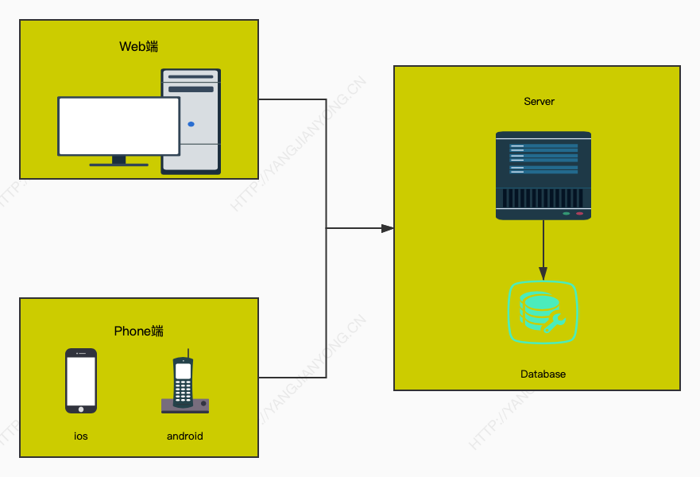
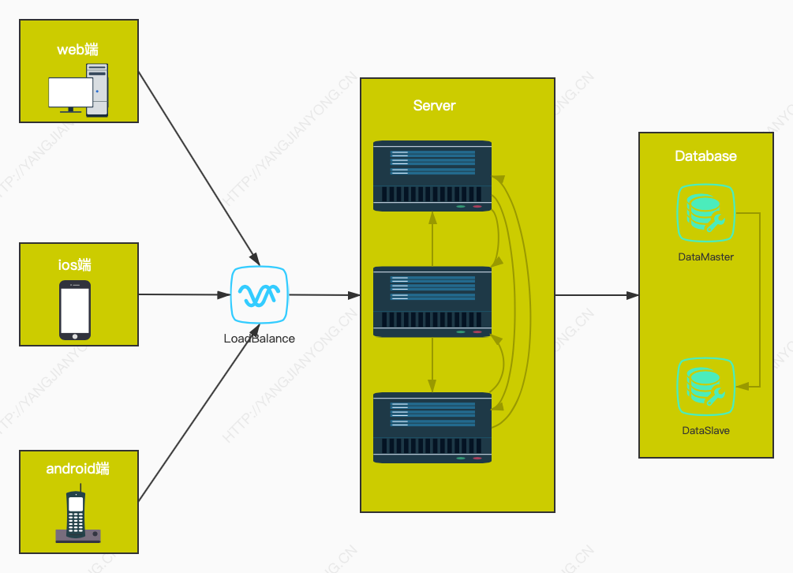
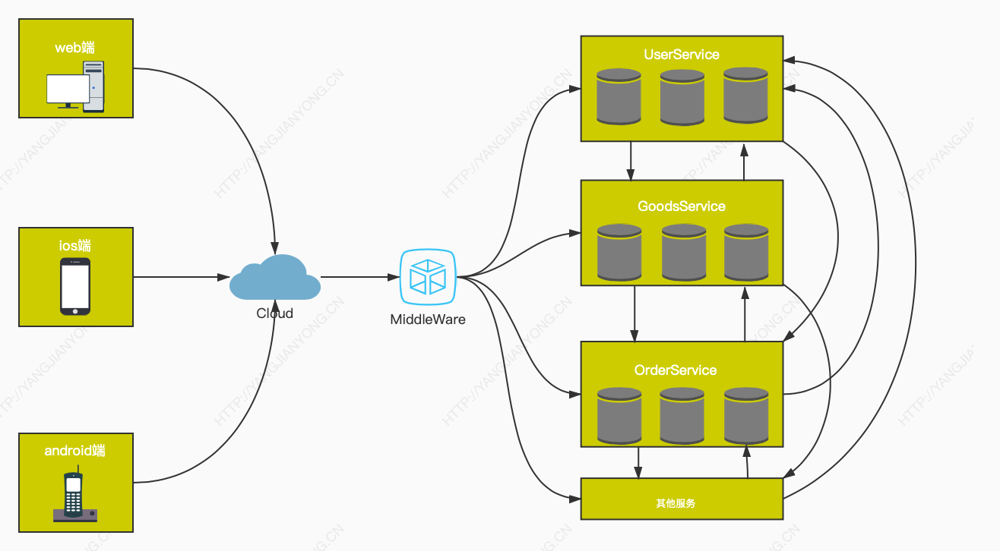
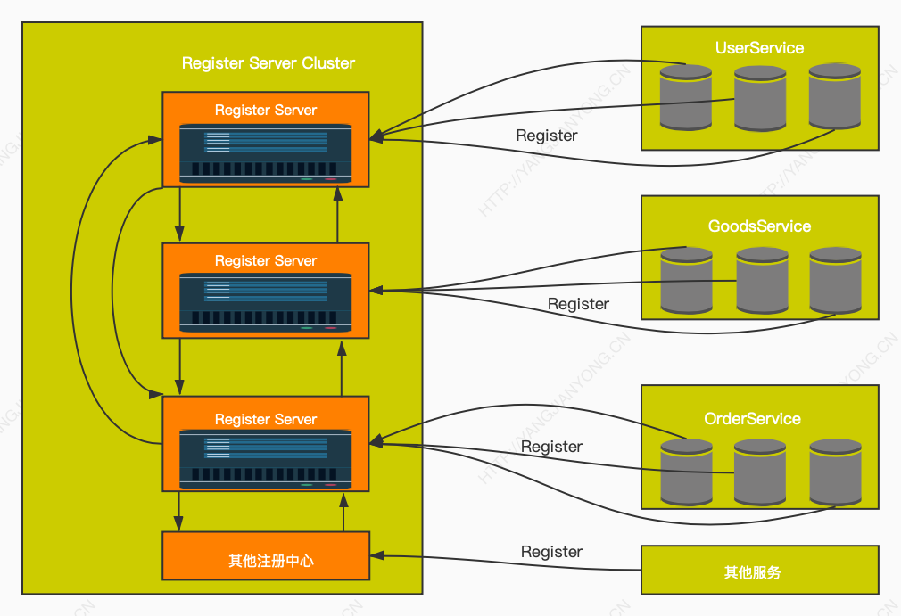
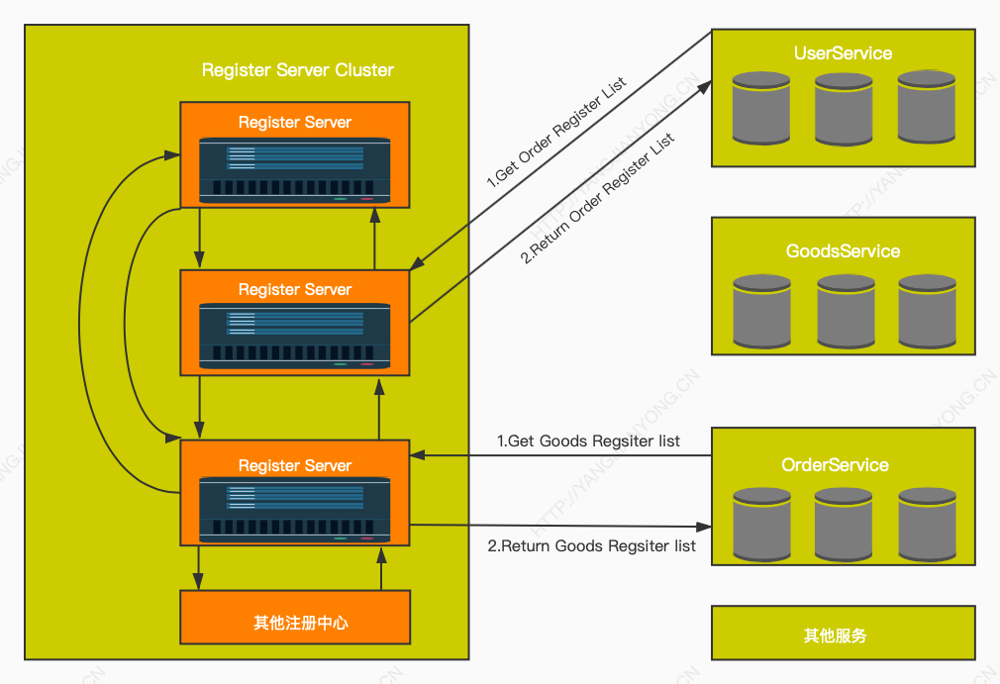
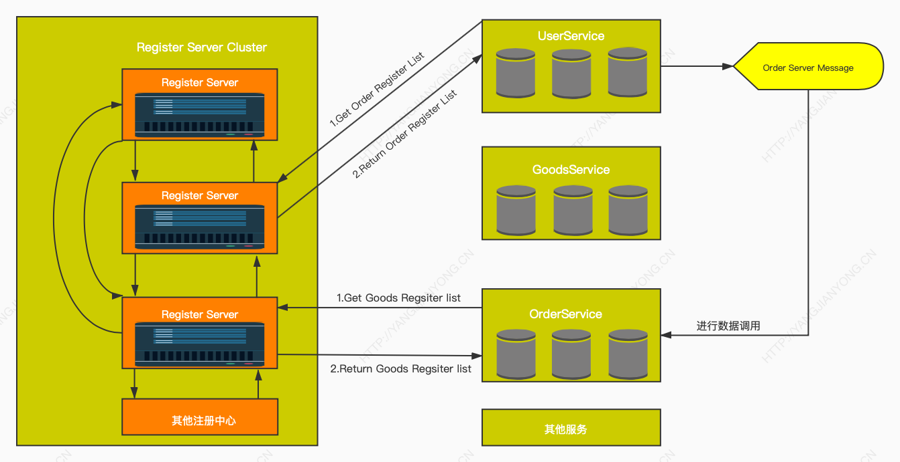
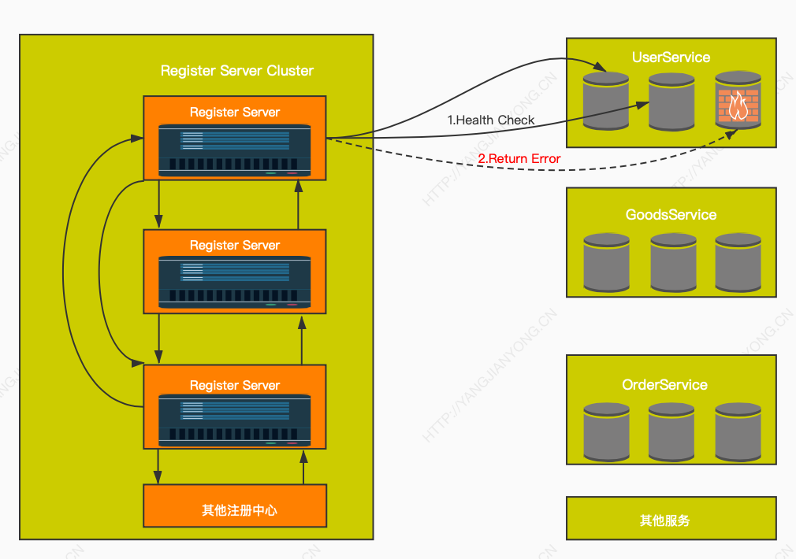

#### 现在最为流行的软件架构就是微服务，也确实微服务带来的生产效率更加的提高了。什么是微服务，就是将传统整体大型的系统，根据功能的不同拆分成多个小型的且能够独立运行的服务，再通过有组织的明确定义的 `API` 在各个不同的小型的服务间进行通信。这些多个小型的服务可以由独立的团队管理。

#### `通俗的理解：例如在福特汽车还没发明出流水线这种工作模式之前，一个工人在生产一辆汽车先要从发动机，再到变速箱再到底盘等等最后一辆车的组装完成都会参与到。但是有了流水线的工作模式后，在一条生产线上，按照各个汽车零件的功能划分，分成了不同的生产车间。这些不同的车间按照规定的技术标准生产出零件，最后再组装到一块。`
#### `在我们开发一个电商系统时，电商系统有分用户模块 / 商品模块 /订单模块 /  财务模块等等。整个电商系统就是就是在生产一辆车，车上的不同零件就是电商系统中不同的模块。传统的开发模式就是先把用户模块开发出来让用户可以注册，再开发商品模块可以上线商品，再开发订单模块可以让用户购买等等，在这个过程中程序员会涉及到整个系统的开发，并且都是使用的统一的技术栈。而使用微服务的架构模式，就是类似于流水线。不同的模块将由不同的团队开发，每个团队使用的技不必统一。只需要在对外提供统一标准协议的API接口即可。`

------------

## 微服务的特性

#### `颗粒度小` 每个服务只专注做一件事。例如负责用户模块的团队，就只专注处理用户问题，其他的订单问题 / 商品问题不闻不问。

#### `自主性` 每个独立的服务都可以拥有自己的技术栈，部署环境，独立运行，互不依赖。例如用户模块可以用`php`语言开发部署在阿里云；订单模块可以用`java`语言开发部署在华为云。

#### `轻量化的通信机制` 各个不同的服务之间，通常使用 `REST / HTTP` 协议的接口进行通信。

------------

## 微服务的优点

#### `敏捷性` 微服务促进若干小型独立团队形成一个组织，这些团队负责自己的服务。各团队在小型且易于理解的环境中行事，并且可以更独立、更快速地工作。这缩短了开发周期时间。您可以从组织的总吞吐量中显著获益。

#### `灵活扩展` 通过微服务，您可以独立扩展各项服务以满足其支持的应用程序功能的需求。这使团队能够适当调整基础设施需求，准确衡量功能成本，并在服务需求激增时保持可用性。

#### `轻松部署` 微服务支持持续集成和持续交付，可以轻松尝试新想法，并可以在无法正常运行时回滚。由于故障成本较低，因此可以大胆试验，更轻松地更新代码，并缩短新功能的上市时间。

#### `技术自由` 微服务架构不遵循“一刀切”的方法。团队可以自由选择最佳工具来解决他们的具体问题。因此，构建微服务的团队可以为每项作业选择最佳工具。

#### `可重复使用的代码` 将软件划分为小型且明确定义的模块，让团队可以将功能用于多种目的。专为某项功能编写的服务可以用作另一项功能的构建块。这样应用程序就可以自行引导，因为开发人员可以创建新功能，而无需从头开始编写代码。

#### `弹性` 服务独立性增加了应用程序应对故障的弹性。在整体式架构中，如果一个组件出现故障，可能导致整个应用程序无法运行。通过微服务，应用程序可以通过降低功能而不导致整个应用程序崩溃来处理总体服务故障。

------------

## 微服务解决了什么问题

#### `缩短开发时间` 微服务可以通过分布式部署，大幅的提升团队的开发效率。相较传统的线性开发，微服务架构下可以并行开发。
#### `快速上线产品` 缩短了开发时间，等同于加快产品面市，可帮助企业快速抢占市场。
#### `高度可扩展` 在服务独立的背景下，在原有的系统上新添加功能模块比传统单体架构显得更加容易。
#### `更加稳定` 传统的单体架构下，一旦某一个模块出问题，整体服务将停摆。而微服务可以将各个独立的服务重复部署，这样将大大的增加整体系统的稳定性。
#### `易于部署` 由于各个服务的独立化，可以使用不同的技术栈。不用再去操心部署的问题。

------------

## 实现微服务涉及到的技术

#### `服务注册与发现` 服务注册就是把某个微服务的通信信息注册到一个公共的组件中心，比如常用的 `zookeeper / consul`。服务发现就是跟服务注册相反的，每一个在组件中心注册的通信信息要能够及时的被其他微服务发现。要理解服务注册与发现，要先来看下架构的发展史：

##### Web1.0架构:

#### 从上图就可以看出，传统的`Web1.0`的架构是很简单的，不同的请求 `Web / Ios / Android` 直接请求 `Server`，甚至很多时候都是把 `Server` 跟 `Database` 放在一起的。这种架构对于小型的系统来讲其实算是效率最高最稳定的，对于不复杂的系统来讲，这种架构是最合适的。

##### Web2.0架构:

#### 在云计算时代，我们不必再独立购买主机了，只需要把所有的服务搬到云上即可。当我们的请求越来越多，数据量也越来越多的时候，单台服务器已经扛不住请求了，这时候就需要把增加处理请求的`Server`，然后再把所有的请求入口统一到一个负载均衡中心，利用负载均衡技术把请求平均到分发到每个`Server`。同时在数据库也可以利用主从的方式来增加并发量。在`Web2.0`架构时代中，依然还不需要用到服务注册与发现。

##### 进入微服务架构:

#### 注意：在这之前，多数人还是将所有的功能某块放在同一台服务器。但是在微服务架构中，是按照功能某块来划分的。这一点对于理解微服务是重要的。
#### 随着用户越来越多，业务也越来越复杂的之后，为了摆脱传统架构中，牵一发而动全身的问题，现代采取的方式就是把不同功能划分开，如图中所示的，`Order / Goods / User` 这些功能模块划分开来。这样做的好处就是，每个功能模块各司其职，进行了深度的解耦，能够快速的实现更新，其中一个服务挂了也不会影响到其他服务。
#### `同时也带来了问题，从图中就可以看出，服务之间的调用复杂度增加了、服务的管理难度变大了、各个服务之间调用的性能开销也变大了[速度变慢了]、排查问题的难度增加了。在现在的云时代，我们会把我们的产品直接上云，会用 docker，会用 k8s，。在未使用服务注册之前，我们在每个服务之间调用使用的方式就是把各个不同服务的 IP 地址和 Port 端口写死在配置文件里，有的甚至硬编码到代码。这样做随之而来的问题显而易见，就是有增加或者减少服务时，就要到所有的服务更改 IP 和 Port 端口，这样做明显耗时耗力。`

##### 服务注册的出现:

#### 有了问题就会有人去解决。服务注册的出现就是解决了服务管理的问题。图中的 `Register Server Cluster` 就是服务注册集群。当有服务启动或者增加的时候，例如图中的 `Order / User / Goods` 的服务，就去服务注册集群中心注册自己的相关信息，也就是把自己所在的 `IP` 地址以及 `Port` 端口注册上去。

##### 服务发现:

#### 从图中就可以看出，所在服务需要获取其他服务的地址信息，只需要发送请求给服务注册中心，然后服务注册中心再返回就可以了。
#### 这里进行服务发现的方式有很多。有通过 `HTTP` 轮询的方式，或者是通过 `SUB/PUB` 的方式，也有通过 `RPC` 的方式都可以。
#### `通过以上的这种方式，把所有的服务信息都放在注册中心进行管理，这样就可以让我们不再繁琐的不断的去更新服务地址信息了。`

##### 服务调用：

#### 当某个服务从注册中心拉取到其他服务的地址信息后，就根据地址信息去获取数据。

#### `健康检查`

#### 看到这边的童鞋，有的可能会好奇。难道一个服务注册中心要做的事情其实就这么简单了吗。其实不然，在上面提到的微服务的架构可以提高稳定性，就是可以重复部署。与重复部署相关的一个事件就是`健康检查`。
#### 健康检查的进行是由注册中心发起的，实现的方式同样有很多种。最终的结果都是，如果有服务返回的状态码不是约定的为健康的，例如 `HTTP` 协议的 `200` ，那么就标记这台服务不可用。
#### 如图中所示，在一个用户服务中，有多个不同的实例，当其中一个实例挂了之后，可以立马部署。甚至可以部署多个，只要其中一个实例挂了之后立马启用备份的实例。
